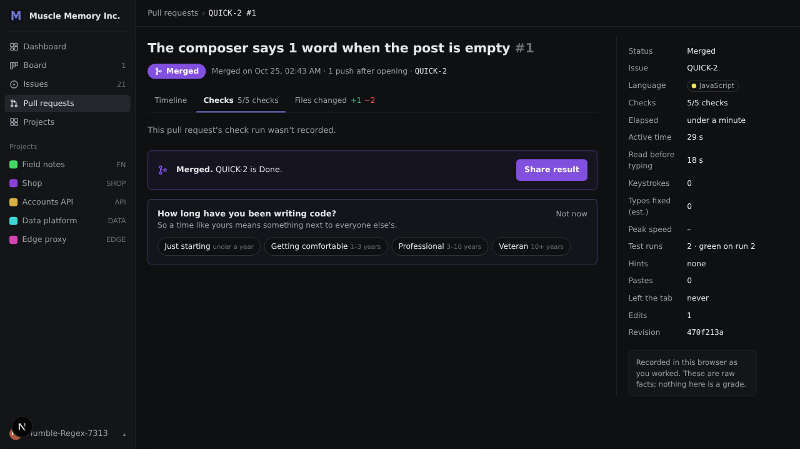
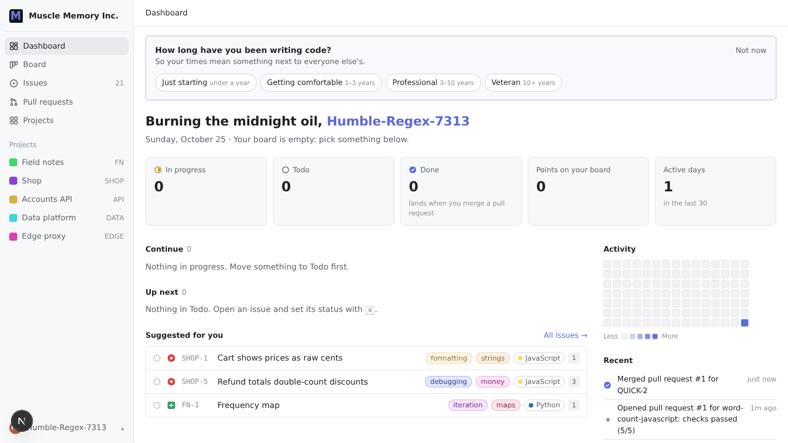
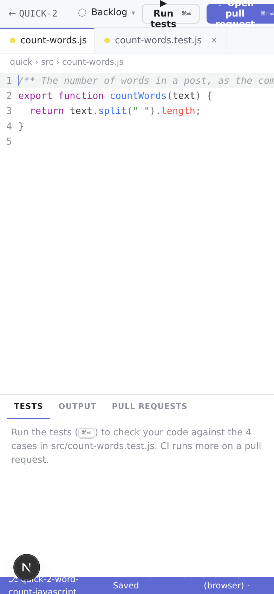
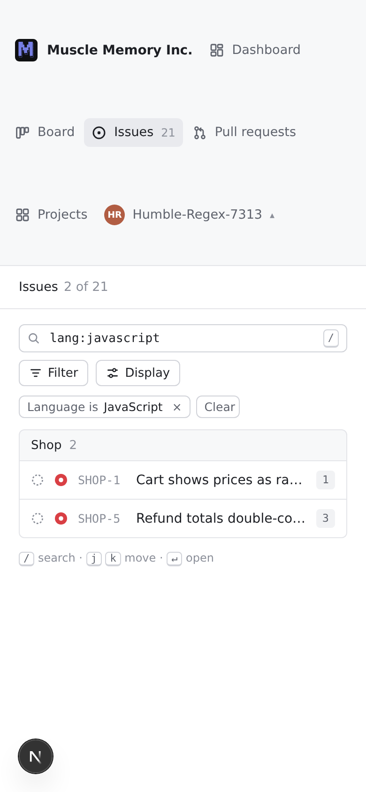

# UI/UX audit · 25 October 2026

Audited `origin/main` at `9c36f09` on branch `audit/ui-ux-2026-10-25`. This is an audit, not an implementation change.

The central experience is promising: familiar tickets, an editor, specific test feedback, deliberate pull requests and private results. The largest gaps are continuity and trust: the first completed exercise disappears from progress, check details can contradict the merge status, privacy settings can default against the user's existing choice, and mobile entry leads into an unusable workspace. Fix these before spending effort on a visual redesign.

## Product intent and audience

Sources: [README](../../README.md), [issue model](../issue-model.md), [workspace](../workspace.md), [play](../play.md), [profile](../profile.md), [telemetry](../telemetry.md), and [legal](../legal.md).

Muscle Memory should help people retain and rebuild unaided coding fluency through short, realistic engineering work. It should feel like a developer's job, with private feedback and room to improve. Granular recording supports the product and future analysis; it must not overwhelm the player's reason for being here. Deterministic tests and prewritten teammate feedback are part of the experience. Runtime AI assistance is outside the product's promise.

These audience assumptions are hypotheses, not research findings:

| Audience | Likely motivation and preferences | Flow to optimize |
| --- | --- | --- |
| Working developer using AI regularly | Preserve fluency in a familiar language; limited time; believable tasks; low setup cost; keyboard efficiency; no public embarrassment | Choose a suitable ticket → code → understand feedback → merge → return later |
| Developer returning after a break | Rebuild confidence; gentle entry; clear expectations; distinguish infrastructure failure from personal mistakes | Find a warm-up → make a small improvement → understand success → choose the next step |
| Curious visitor arriving from a shared result | Decide quickly whether the challenge is interesting; may initially be on a phone; wants to know time and privacy cost | Shared receipt → language → first useful run → finish → optional share |
| Research-conscious participant | Know what is collected, what is published, and how to control it; durable choices | Understand recording → set privacy → practice → review or delete data |

Do not assume that familiarity with programming implies enthusiasm for terminal-based account settings, research participation, speed comparisons, or an eight-hour work metaphor. Validate those separately.

The strongest success measures would be accepted-start-to-first-run, first successful merge, successful resumption of unfinished work, another issue started after a merge, and voluntary return. Profile completion and sharing are secondary. Do not introduce pre-acceptance analytics to fill the deliberately unmeasured visitor funnel.

## Method and coverage

Used the T3 collaborative browser against the LAN dev server, with an isolated incognito profile and synthetic practice. Used a separate localhost origin for a genuinely fresh profile. Read the corresponding implementation to confirm causes where useful. No production player data or external posts were involved.

Desktop inspections used 1440×900 and 1366×768; narrow-layout inspections used 390×844. This was Chromium on Linux, with light and dark states. Narrow viewports test CSS layout, not a physical phone, touch keyboard, or mobile browser engine.

| Surface | Coverage |
| --- | --- |
| `/` | Headline, calls to action, time expectations, product claims, content hierarchy, desktop visual inspection |
| `/play` | Fresh entry, language selection, recording disclosure, desktop and narrow layout |
| `/consent` | Fresh gated entry, acceptance and return to dashboard; signed-out return and same-handle sign-in |
| `/dashboard` | Fresh profile, dismissible question, suggestions, empty state, activity and post-merge progress |
| `/issues` | Full catalog, language search, URL state, zero results, narrow layout, keyboard navigation |
| `/issues/SHOP-1` | Ticket, acceptance criteria, contextual keybinding question, keyboard status changes, Start work |
| `/projects`, `/projects/SHOP` | Index, project context, fit/stack descriptions, linked issues |
| `/board` | Empty state during initial load, populated board, status continuity; reviewed list-mode implementation |
| `/work/QUICK-2`, `/work/SHOP-1`, `/work/FN-1` | JS edit/run/push flow, Python startup and failed results, keyboard escape, saved-code restoration, narrow IDE |
| `/pulls`, `/pulls/QUICK-2/1` | List, timeline, passing push, merge, check details, diff, result questions and sharing |
| `/r/<card>` | Generated preview image, public receipt, same-language referral CTA; copy link over LAN HTTP |
| `/settings` | Terminal menu, theme, privacy, stealth revisit, logout; reviewed profile/reset/delete implementation |
| `/terms`, `/privacy` | Visible drafts, disclosure, local-account limitations, contacts and product claims |
| Missing issue | Default 404 within app navigation |

Completed a synthetic JavaScript attempt: starter 2/4 local checks → failed PR 2/5 → corrected local run 4/4 → push 5/5 → merge → share preview → copied link → shared receipt. Python booted and reported the expected starter failures. The automation inserted the JS edit programmatically, so its zero-keystroke receipt is not a measurement of human typing and is not reported as a telemetry defect.

Not covered: physical mobile devices, Safari/Firefox, assistive-technology sessions, production performance or network throttling, all language runtimes, long-session storage failure, full blocking-review/hint behavior, server erasure, aggregate availability, and real social-network posting. Reset/delete were inspected, not executed. Dev compilation delays and the Next.js development badge are not product findings. No application code changed, so unit/build suites were not rerun.

## Findings, in recommended order

Priority definitions: **P1** materially undermines the core flow or trust; **P2** creates substantial friction or comprehension problems; **P3** is polish or a hypothesis to validate. “Observed” means reproduced here; “inferred” means the impact or cause needs further testing.

### 1. P1 · PR check details can falsely say the run was not recorded

**Observed.** After the passing second push and merge of QUICK-2 #1, the header and sidebar showed 5/5 checks, while Checks displayed “This pull request's check run wasn't recorded.” Reloading reproduced it.

The synthetic run's result was present in IndexedDB. The PR event was timestamped `17:42:37.640Z`, sequence 36; the matching terminal run event was `17:42:37.641Z`, sequence 37. [pullRequestDetail](../../apps/web/lib/pulls.ts) limits its observation window to `occurredAt <= pull.at`, excluding the outcome. This is timing-sensitive; the first push's events shared a timestamp.

**Change:** associate the selected push with its terminal result by run ID and source ordering; use time windows for surrounding activity, not to discard the run's own result. Keep actual capture failures distinct from unavailable revision metadata.

**Acceptance:** a result arriving after the PR event still renders all visible checks and correctly masks hidden cases; test the one-millisecond boundary and multiple pushes.

### 2. P1 · Completing the quick test does not count as personal progress

**Observed.** Immediately after merging QUICK-2, the dashboard said “Your board is empty” and Done 0, alongside “Merged pull request #1 for QUICK-2” in Recent. The board also omitted that completed issue. `/pulls` displayed `word-count-javascript` instead of its title/key and omitted its language. Its link redirects successfully to the canonical PR, so it is not a dead link.

[Library construction](../../apps/web/lib/library.ts) excludes unlisted projects from `issues`; dashboard, board and pull-list metadata receive that same list. Hiding QUICK from discovery should not erase work someone has done.

**Change:** separate discoverable issues from metadata for the person's recorded work. Include completed and unfinished quick-test work in personal progress and history, while keeping it out of general suggestions.

**Acceptance:** finishing the first quick test yields Done 1, a correctly titled PR, and consistent board/recent history. Leaving it unfinished provides a way to resume.

### 3. P1 · The mobile entry path leads into a broken IDE

**Observed at 390×844.** Run tests and Open pull request wrap beyond their fixed-height header; the PR control extends beyond the right edge. Status-bar text overlaps/wraps. Ticket and Explorer controls disappear entirely. [IDE CSS](../../apps/web/app/work/ide.css) hides both the activity bar and sidebar below 860px, so this also affects tablet-width layouts. A multi-file task loses access to files not already open.

**Change:** provide accessible Ticket/Files drawers and a compact action bar, with readable labels and a menu for secondary commands. Until that is viable, make the desktop requirement clear before starting and provide a useful handoff without implying progress synchronizes between devices.

**Acceptance:** at 390px and tablet widths, a person can read the ticket, open every needed file, run tests, open a PR and navigate back without clipped controls. Verify with a real mobile keyboard as well.

### 4. P1 · Recording disclosure appears after the action that accepts it

**Observed.** `/play` puts the disclosure below all eight language buttons. At 390×844 the first buttons begin around y=604 and the last row around y=780; the disclosure is below the initial viewport. A click on “JavaScript” both accepts the Terms and starts recording, even though “Pick your language” sounds like preference selection.

The [component](../../apps/web/app/play/play-start.tsx) and [play docs](../play.md) say the notice is above the buttons, but the actual DOM places it after them.

**Change:** move the short recording/age/acceptance notice before the actionable choices; label the section “Choose a language to start” or make the action explicit in each button. Link to privacy controls without requiring a scavenger hunt after starting.

**Acceptance:** a fresh visitor can see the disclosure before the first start action at narrow and desktop widths and in keyboard reading order. This is a comprehension finding, not a legal determination.

### 5. P1 · Privacy defaults to sharing even when stealth is already enabled

**Observed.** Settings → privacy → No successfully enables stealth. Reopening privacy says “Right now you're in stealth,” then offers `(Y/n)`. [settings-terminal.tsx](../../apps/web/app/settings/settings-terminal.tsx) hardcodes `initial: true`; Enter therefore selects sharing rather than preserving the existing preference.

**Change:** initialize the control from the stored state, or offer an explicit “Leave stealth” action with a clear change summary. Preserve choices when revisiting settings.

**Acceptance:** reopening privacy and pressing Enter cannot silently reverse stealth. Explicitly choosing sharing still works and explains the result.

### 6. P1 · Saved-code restoration gives an alarming, internally confusing warning

**Observed; cause not fully diagnosed.** Reopening QUICK-2 restored the exact corrected code, but announced: “Restored revision 1 from an earlier session … Later saved changes (up to revision 1) were not recovered: later activity could not be recovered.” No newer code revision was identified. The warning sits in faint, narrow panel-header text.

**Change:** investigate replay/session ordering separately from the UI. Distinguish incomplete activity history from lost code, identify affected revisions when known, and offer a readable recovery explanation. Do not suppress a real gap simply to remove the warning. Relevant paths: [save-state.ts](../../apps/web/app/workspace/save-state.ts), [restore.ts](../../packages/capture/restore.ts).

**Acceptance:** a normal save → leave → reopen restores the code with an accurate status. If only activity is incomplete, the message says that; if code might be missing, identify what was restored and what the player can do.

### 7. P2 · The first dashboard asks for information before helping someone start

**Observed structure; inferred conversion impact.** A fresh profile sees an experience question, five mostly empty statistics, empty Continue and Up next sections, then suggestions. Copy instructs “Move something to Todo first,” although Start work can immediately move an issue into progress. Language choice is more useful for selecting a first task than experience, but is asked later.

**Change:** make a suitable first issue or quick test the primary action. Place optional language personalization next to suggestions, retain Not now, and defer empty dashboard modules until they are useful. Explain why each recommendation fits.

**Acceptance:** a new visitor can find and start an appropriate task without learning the board's status workflow or answering profile questions. Returning users see their unfinished work first.

### 8. P2 · Completion has no clear continuation into a practice habit

**Observed.** The merged state offers Share result and a profile question; the ordinary sidebar is the route to more practice. The result facts live in the side column, while the long timeline remains central. There is no focused “next issue” action or clear transition from the trial into ongoing practice.

**Change:** give completion a compact summary, one suitable next issue, and a return-to-desk action. Keep sharing optional. Preserve the diff and raw facts behind clear navigation. Avoid turning speed, typos and pastes into an overall ability grade.

**Acceptance:** after the quick test, the next relevant practice task is visible with its language and difficulty, and the completed test remains recognizable in history.

### 9. P2 · The account and persistence model is disclosed too late

**Observed.** Public entry says “No account, no email”; inside the app, the person is “signed in” with a handle and can log out/delete an account. Browser-only identity and progress loss on changing devices are explained in Terms and some later messages. “Sent to our servers” can reasonably suggest cloud-backed progress even though the server receives records rather than a resumable account.

**Change:** say near entry or the first saved session: “Progress is saved in this browser. No email or cross-device sync yet.” Distinguish local progress, uploaded records and published datasets. Keep logout's existing preservation message.

**Acceptance:** a player can explain what happens on another device, after clearing storage, after logout, and after delete without reading the full Terms. Do not imply that uploading means account recovery exists.

### 10. P2 · Mobile browsing spends excessive space on navigation and hides decision data

**Observed.** At 390px the wrapped app sidebar occupies roughly 283px before the page header. Issue names truncate to “Cart shows prices as ra…” and “Refund totals double-co…”, and language/label chips disappear. These are the details needed to choose a task. No page-level horizontal overflow was observed on this inspected list.

**Change:** use a compact app header with a navigation drawer. Allow issue titles to wrap and retain language plus difficulty; move secondary tags into the detail page. Prioritize Start work above long issue content on narrow screens.

**Acceptance:** the first useful issue is visible without scrolling past a large navigation block; full titles and language are available without hover.

### 11. P2 · Low-emphasis text is too faint for information people need

**Measured.** Light `--faint` is `#8b8f99`, about 3.24:1 against white; dark `--faint` is `#6c6f78`, about 3.79:1 against `#0f1012`. It is used for 11.5–13px instructions, timestamps, breadcrumbs and recovery/status information. Actual adjacent panels can reduce contrast further. This is a targeted palette finding, not a full accessibility conformance assessment.

**Change:** use a stronger text token for instructions and state; reserve faint color for nonessential decoration. Audit small green/amber status text and syntax colors separately, without relying on color alone.

**Acceptance:** essential text remains legible in both themes, including all recovery messages and empty-state guidance. Verify computed foreground/background pairs rather than only reviewing screenshots.

### 12. P2 · Tab controls and shortcuts are only partly consistent with their presentation

**Observed.** PR tabs expose `role=tab`, but ArrowRight from Checks neither moves focus nor changes the tab; there are no `tabpanel` elements. Tab and click still work. The Linux browser sees Mac-only `⌘` labels throughout the editor, even though tooltips mention Ctrl/⌘. Escape then Tab correctly exits the editor, but that escape route is documented rather than visible in the workspace.

**Change:** implement a coherent tab keyboard/relationship pattern; show platform-appropriate shortcuts; add a small accessible keyboard-help surface explaining focus escape and essential commands. [PR tab component](../../apps/web/app/(browse)/_components/pulls.tsx), [IDE](../../apps/web/app/work/ide.tsx).

**Acceptance:** tab groups support expected keyboard navigation and panel relationships, Windows/Linux labels show Ctrl, and keyboard users can discover how to leave the editor. Validate with an actual screen reader before claiming accessibility coverage.

### 13. P2 · Settings changes interaction language and makes small edits unnecessarily sequential

**Observed design; usability impact is a hypothesis.** The tracker becomes a full-page terminal without its navigation. Changing profile answers runs through all questions; the dashboard's “Your stack → Change” goes to generic settings rather than directly to languages. Returning through several commands builds a long transcript. This may delight some developers, but it adds work to routine privacy and preference changes.

**Change:** retain the terminal as an optional presentation if desired, while providing direct links to profile/languages/privacy/theme and a persistent Back control. Separate destructive actions visually. Existing reset-default-No and typed-handle delete confirmation are good safeguards to preserve.

**Acceptance:** someone can change only languages or inspect privacy in one direct route, cancel without changing other answers, and return to the previous task with mouse, keyboard or touch.

### 14. P2 · Activity presentation exposes raw event phases rather than meaningful actions

**Observed.** Recent shows separate “Ran … (queued)”, “Ran … (running)” and “Ran …” rows for a single local test, and a second push can read as another “Opened pull request #1.” This crowds useful history out of the eight-row feed. A fresh account also showed Active days 1 before any code practice, so that label includes broader app activity.

**Change:** keep raw events unchanged, but group display rows by run ID and distinguish opening from pushing. Name active days precisely, or derive practice days from the intended behavior with an explicit definition.

**Acceptance:** one test run becomes one feed item, a push says “Pushed,” and people can understand what counts as an active day. If any recorded observation's meaning changes, follow the capture-version rules; presentation grouping alone need not change raw data.

### 15. P2 · Product claims and preview limitations need a single consistent story

**Observed copy mismatch.** The homepage promises an honest read on skill change, private progress and aggregates. Privacy/settings describe LLM comparisons as working; the README calls research collection and model benchmarking later work and the current demo synthetic. The deployed telemetry design is more advanced than that README summary. Terms/Privacy are visibly drafts with placeholder company/contact/region information.

**Change:** distinguish available capabilities from planned ones on every surface, explain insufficient comparison data, and reconcile the README with actual recording behavior. Resolve placeholder identity/contact information before public onboarding. This audit does not assess legal validity.

**Acceptance:** the same clear statement of what works today, where data goes and how to contact the operator appears across entry, settings and legal pages. Draft notices remain honest until the underlying review is complete.

### 16. P3 · The work metaphor competes with the short-practice promise

**Observed copy; inferred impact.** “Five-minute test” sits beside a schedule from 9:00 to 4:55, beginning with paperwork. “Can you still code?” is repeated on landing, play and shared results. The homepage provides no actual workspace preview before a long text explanation. Numeric estimates appear as bare 1/2/3 points in lists, offering little time guidance.

**Change:** keep workplace character, but explain that tickets fit short sessions and progress can wait. Test a confidence-building alternative to the challenge framing. Show a truthful workspace preview and clarify points versus time; do not invent duration estimates without evidence.

**Acceptance:** a first-time visitor can describe the task, likely commitment, available help and next action after one screen. Validate this with both regular AI users and returning developers.

### 17. P3 · Loading and recovery states should offer context rather than apparent emptiness

**Observed.** Full page loads briefly show Anonymous, empty board counts or blank pull content before browser-local data loads. The hydrated account and progress then appear. Empty searches explain how to recover but do not offer a prominent reset action for plain-text queries; missing issues use the default 404 message.

**Change:** distinguish loading from known-empty data, retain stable layout, add a clear search reset and a useful issue-not-found recovery link. Do not label storage-read failures as ordinary empty history.

**Acceptance:** slow local reads show a loading state rather than “empty”; actual storage errors explain the problem; zero results and missing links offer an immediate route back to valid work.

## What to preserve

- The coherent, restrained desktop tracker and IDE visual language, readable main text and meaningful project context.
- Immediate examples and expected/actual values on local test failures. JS and Python feedback were useful without making personal judgments.
- The distinction between running tests, pushing to CI and deliberately merging; passing checks did not silently finish the issue.
- Optional questions and working Not now dismissal; no mandatory profile setup.
- Search/filter state represented in URLs, keyboard issue navigation, keyboard status selection, and working editor focus escape.
- The share preview, “never your code” explanation, functional LAN clipboard fallback and same-language referral destination.
- Explicit draft notices and the signed-out return flow that retains the handle and local work.

## Delivery sequence and validation

1. **Restore trust and continuity:** findings 1–6. Add focused regressions for late result events, unlisted personal work, preserved stealth and normal restoration. Verify the complete first-test loop in the browser.
2. **Make starting and returning obvious:** findings 7–10 and 14. Design fresh/unfinished/completed dashboard states and one clear post-merge action; compact narrow navigation.
3. **Make interaction and claims consistent:** findings 11–13, 15 and 17. Check both themes, keyboard and screen-reader behavior, direct settings paths, loading failures and copy consistency.
4. **Validate the positioning:** finding 16. Observe a small set of working AI-using developers, returning developers and phone-arrival visitors. Ask them to start a fitting task, explain recording, enable stealth, resume work and find their result. Record confusion and completion without coaching; do not treat this heuristic audit as proof of their preferences.

Prefer an improved first successful practice session over adding more dashboard statistics. Preserve the raw-data model, deterministic feedback and absence of runtime AI while improving the presentation around them.
