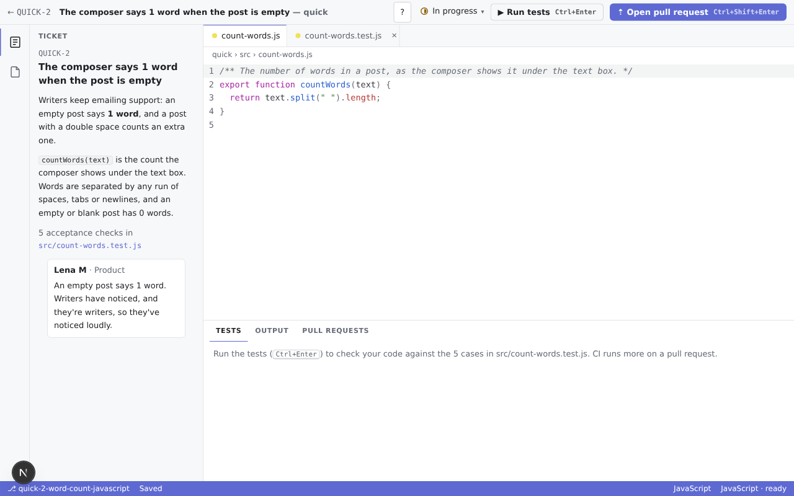
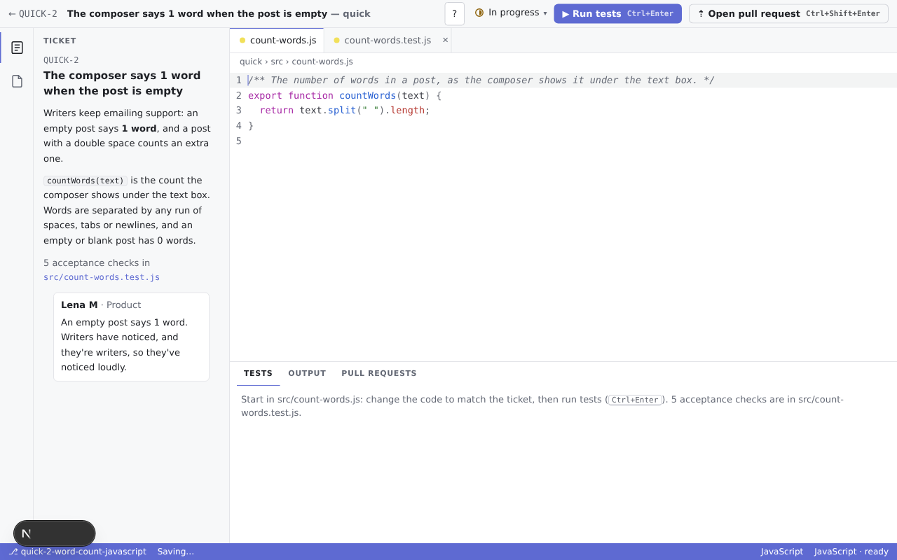
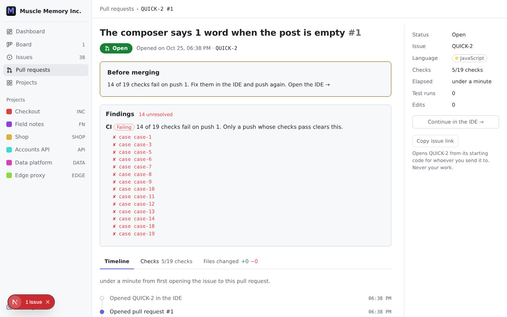
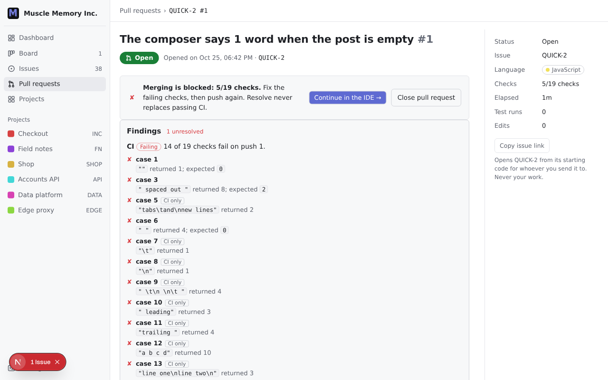
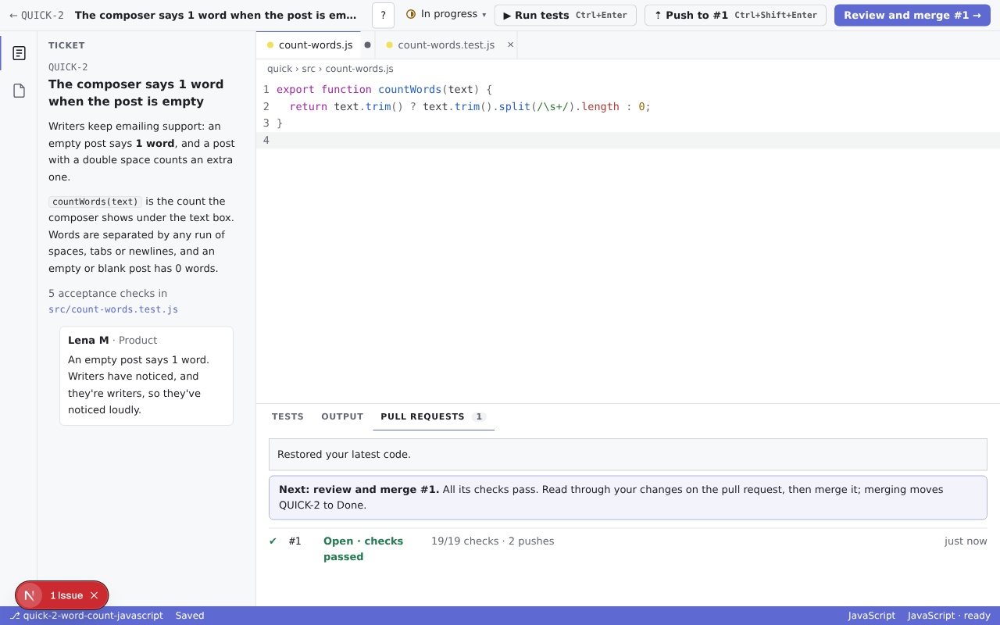
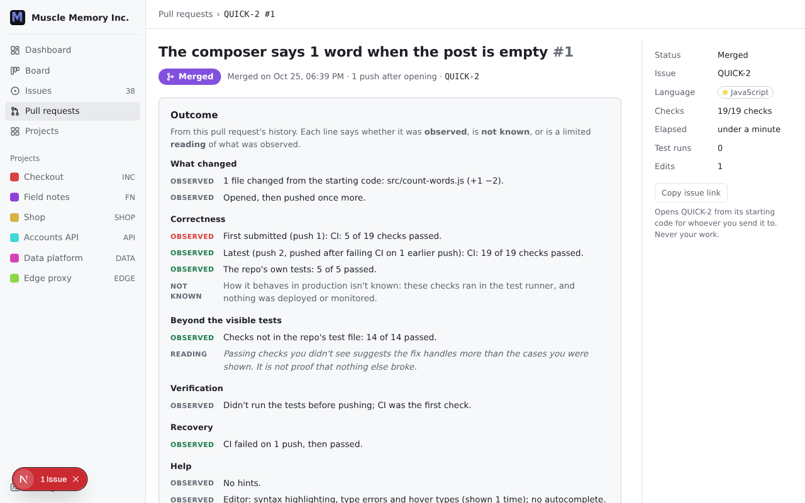
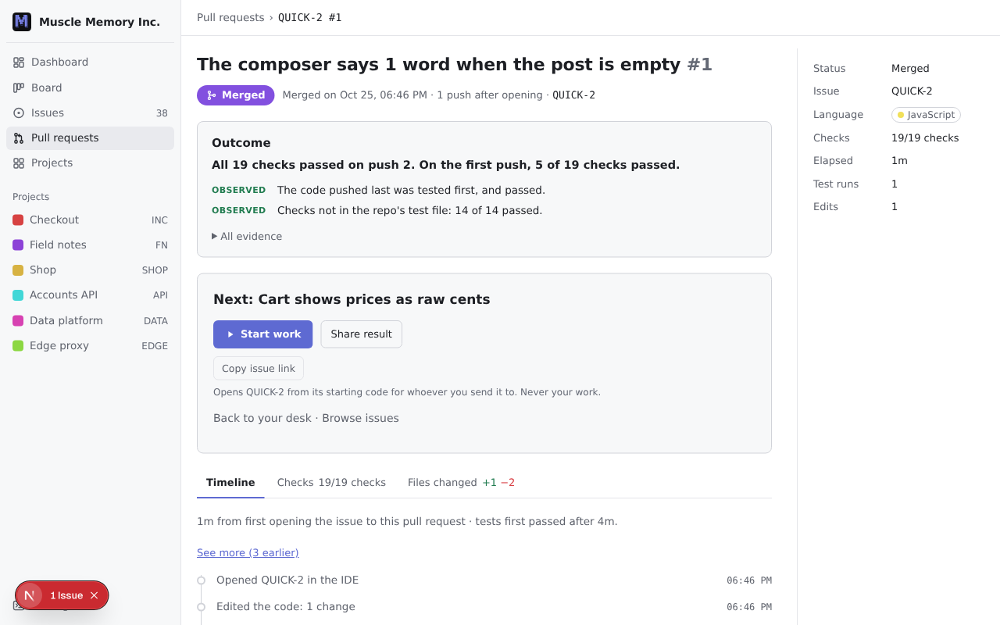

# ENG-328 verification and handoff

The [keep/change/remove inventory](eng-328-loop-audit.md) was committed before implementation. The starting release is `1edfb853356f7ee8cb53d5fef8efe4a5e070bfc8`. Remote main still matched at integration. The branch explicitly stacks on ENG-329 PR #38, including its focusable Findings heading (`12567c9`); no other remote work is included. No merge or deployment was performed.

## Before and after

Synthetic local attempts, Chromium, 1280 × 800, light theme. Before is the exact release baseline; after includes ENG-329's brief outcome and diagnostic components composed by this stream. No human validation is claimed.

Arrival: the ticket and source are already open; Run tests leads, and the panel names the entry file.

Failed PR: the recovery action precedes Findings; the duplicate Before merging block is gone. ENG-329's diagnostics show what happened; CI-only expected answers are withheld pending dot's product review.

Current passing CI: the header owns Review and merge; the panel no longer repeats a primary button.

Completion: the brief outcome, next issue and optional secondary sharing fit before the history. Full evidence remains available under All evidence.

## Automated keyboard paths

`LOOP_ORIGIN=http://localhost:3128 node --import tsx tools/browser/loop-check.ts` creates an isolated context with synthetic records, accepts Terms through the normal entry, and exercises:

- Arrival: focus language button → Enter → source focused → Run tests is the sole primary action.
- Failure: Ctrl+Enter → failed local tests → Ctrl+Shift+Enter → failed CI → no Merge action → Continue in the IDE by Enter. The open PR has diagnostic CI-only rows and no duplicate outcome action block.
- Runner recovery: force the JavaScript asset request to fail → Retry environment by Enter → restore downloads → tests ready. A nonterminating function → Ctrl+Enter → Cancel by Enter → Tests tab → cancelled result → correct source → current green promotes Push.
- Green: Ctrl+Enter → Ctrl+Shift+Enter → Review and merge becomes the sole primary; editor focus stays put through tests. Reopen IDE → first edit withdraws Review immediately → saved-code gate blocks merging → Continue, correct, test and push → review → Merge by Enter.
- Explicit Resolve: FN-1 passes CI with a debug-print review finding → correcting push does not clear it → Resolve findings anchor focuses heading → Tab reaches Resolve → Enter clears it → Merge becomes available.
- Completion: exactly one next-issue action; Share result by Enter → Include my code is unticked → Escape returns focus to Share result. No duplicate merged box.
- Pause/resume: edit QUICK-3 → save → select tests tab by keyboard → leave and return → same tab and code restored → Escape, Tab exits source editing.

Unit checks cover the action priorities, unknown/stale/review/failed merge verdicts and one-time invalidation after restoring prior checks. The existing merge/evidence/capture regressions remain in the full suite.

## Results and integration limits

- `npm test`: 214 passed, 0 failed.
- `npx tsc --noEmit -p apps/web`: passed.
- `npm run build` with Node 22: passed (content verification and production compilation included).
- Chromium route/keyboard regression above: passed.
- `git diff --check`: passed.

Runtime/worker code and issue content were not changed, so sandbox-all-engines and publish-content execution checks were not required. This verifies local behavior, not a deployment.

ENG-329 is integrated through existing props and `Checks`/`Findings` imports. The formerly unreachable reply handler is wired through. Its CI-only expected-value presentation is a recorded product choice for dot to accept or reject together with that stream.

ENG-332's new artifact controls/metadata are not delivered in this T3 project yet. Existing `ShareResult` and `CopyIssueLink` occupy secondary positions; `NextPractice.share` is the composition slot. Dot must still integrate ENG-332, review all streams, run fresh-context shared-link checks on the combined release, and explicitly authorize any merge/deployment. No evidence, telemetry, consent, code opt-in or serialization logic is rewritten here.
