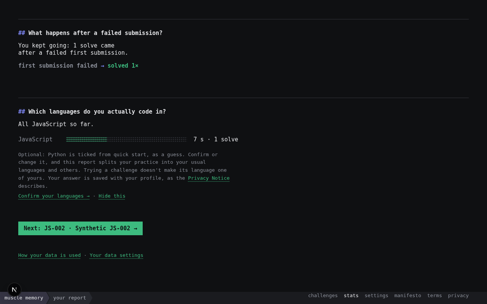
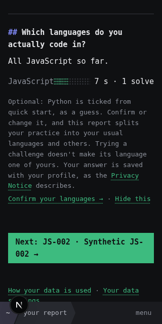
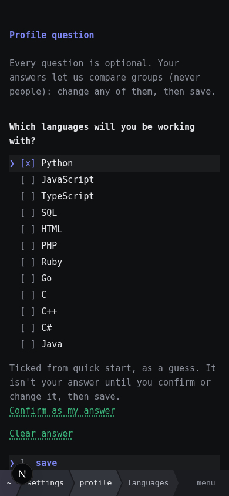
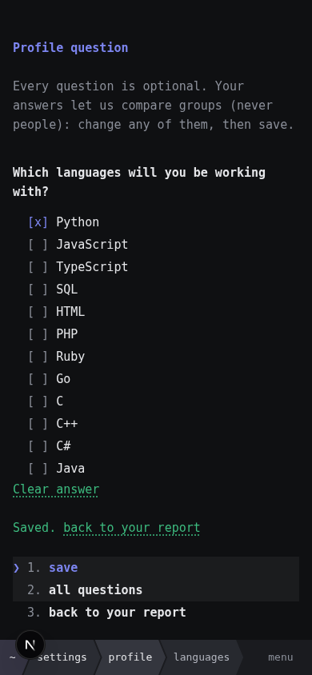
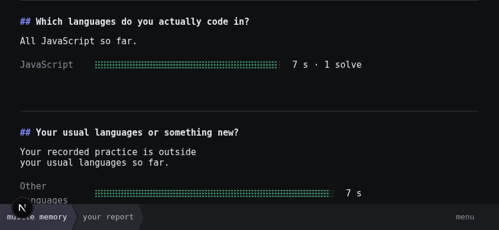
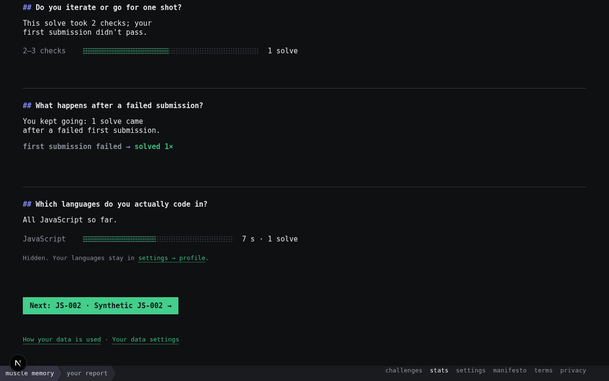

# ENG-360 evidence: the languages invitation

Synthetic only: a seeded profile (Python as an unconfirmed quick-start guess, editor answered) and one fixture JavaScript attempt, in fresh Chromium contexts on a synthetic catalog. Every off-origin and history request was stopped in the browser. Produced by `tools/browser/languages-invite-check.ts` (40 checks over desktop 1280, phone 390, phone 320 and phone landscape 844×390, all passed). WebKit couldn't run on the QA host, and no real devices were used.

| Screen | What it shows |
| --- | --- |
|  | Desktop: the invitation sits under the languages answer, names the guess as a guess, and Next stays first-class |
|  | Phone 320: the same, without horizontal overflow |
|  | The form from the report: the guess is labelled, with Confirm as my answer and Clear answer |
|  | Saved after a deliberate confirmation, with the way back to the report |
|  | Back on the report at the languages answer: the usual/other grouping appears and the invitation is gone |
|  | After Hide this: a one-line confirmation, remembered across reloads |
