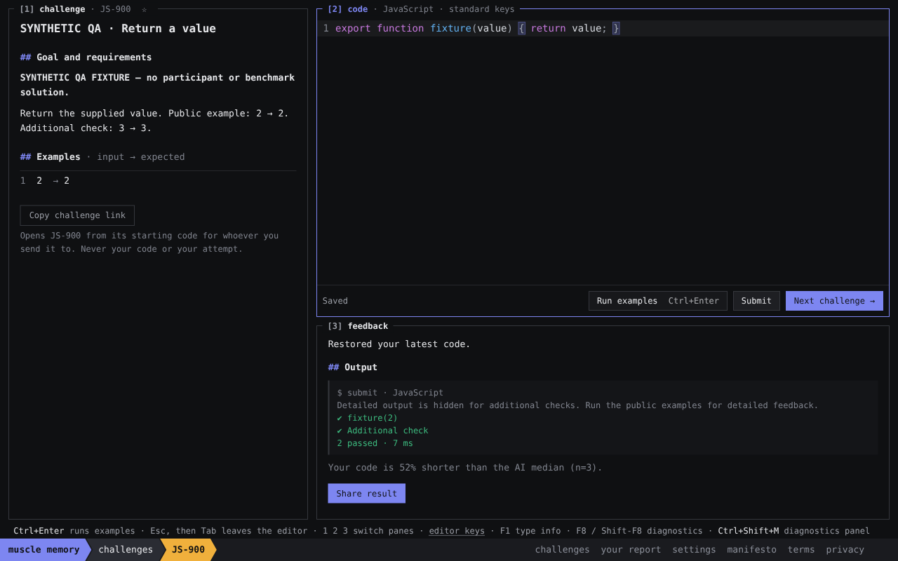
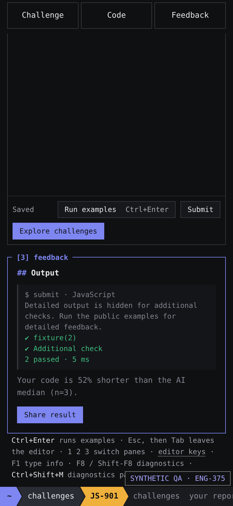

# ENG-375: minimal coding loop correction

This supersedes the earlier result-strip presentation. All screenshot code, challenges and model lengths are explicit synthetic JS-900/JS-901 QA fixtures. The 52% number demonstrates rendering; it is not a benchmark result.

The real editor's Cmd/Ctrl+Enter now runs public examples; the button hint, footer and recorded editor-feature name agree. Submit is disabled until examples pass for the exact current code and runner, and the person session's actual submit/run handler enforces the same prerequisite. Every edit transaction (including paste/undo), new example run, session/challenge/language change and runtime replacement/failure invalidates it. In-flight/stale results cannot re-enable it. Offline model tool protocol is unchanged.

Output stays open without a Done banner, duplicate example results, comparison headings/lists, availability prose, detail/refresh controls, repeat action or an extra report link. Next stays separate from Submit. Share opens the existing dialog directly; Include my code is still unticked every time. A useful FYI needs at least three distinct successful matched default models and a length difference of at least 10% from their median; otherwise nothing appears. No speed or quality claim. Stealth removes the FYI while keeping output and Share.

Reflections are eligible only every fifth completed solve, starting at solve five; the existing questions rotate across those milestones. This uses existing completion counts and persisted local choice/dismissal, with no new collection fields. The first four solves have no question. Answer/skip/reload/repeated submit cannot introduce a second question for that solve.

## Verification

The actual Next app, CodeMirror keyboard binding, session guard and pinned JavaScript browser sandbox were exercised through T3 preview against the explicit synthetic catalog (the production build, not static mockups):

- Initial and failed examples keep Submit disabled; Ctrl+Enter produces example output without submitting.
- Passing public examples enables Submit but does not complete. A public-only implementation then fails a hidden check on Submit with safe feedback.
- Editing disables Submit. Forcing the native button's disabled DOM flag off and clicking it still cannot submit. Undo keeps the prerequisite invalidated.
- Successful Submit shows output then the single synthetic median FYI and direct Share. There are no comparison disclosures/headings/refresh controls and no Done or Practise again.
- Share opens directly with explicit Include my code consent unchecked. Closing/reopening retains that default.
- Next opens JS-901 with Submit locked. Mobile Ctrl+Enter runs examples; controls wrap without page horizontal overflow. Output and Share remain directly accessible.
- With four synthetic prior solves, solve five offers exactly one existing question. Skip followed by repeated Submit leaves it dismissed; ordinary earlier solves have no question.
- Switching stealth on immediately removes the FYI and keeps output/Share.

34 focused tests pass, including actual person-session submit bypass attempts, runner-context/generation changes, missing/failed/unscorable results, median/default/deduplication rules, sparse/trivial/partial-data omission and reflection cooldown/dismissal. Workspace typechecks and a production build pass using the explicitly selected synthetic catalog. Independent review passed the eight new/revised focused tests with no demonstrated blocker. Real-catalog trusted CI and exact final head are recorded in the draft PR.

The managed copy remains unavailable locally; no private-content fallback or credential change was made. `tools/browser/results-fixture.ts` generates the explicitly selected synthetic copy. The managed-catalog browser workflow `tools/browser/practice-check.ts` is updated for keyboard example runs, example-gated Submit, direct Share and picker-based repeat starts; it still requires authorized real catalog access. Stats/report work and ENG-376 human-cohort backend are separate. No merge/deploy instruction has been consumed for this correction.
