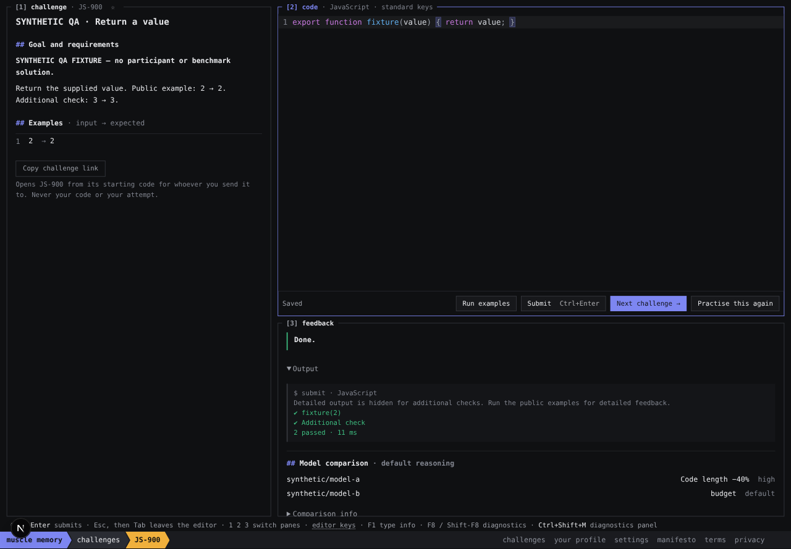
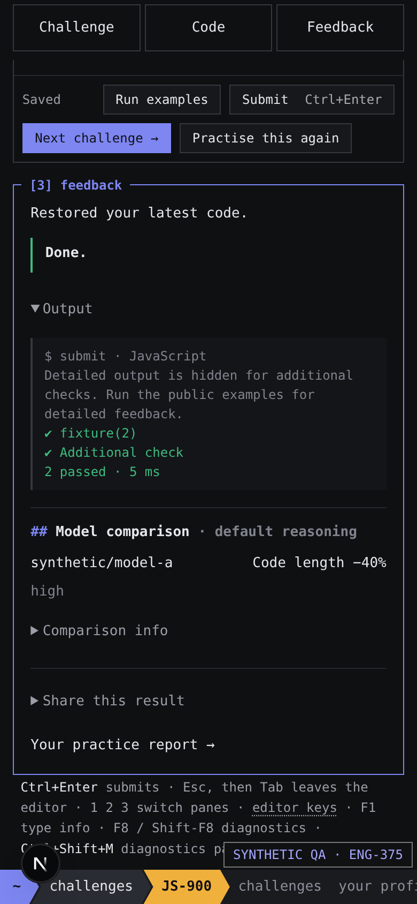

# ENG-375 verification

All pictured code, challenges and model numbers are invented JS-900/JS-901 QA fixtures. No player records, hidden real tests, real model/reference solutions or credentials appear. The −40% figure demonstrates the UI and is not a benchmark claim. Desktop includes a second synthetic model's budget-limited outcome. Mobile includes a QA overlay added solely for labelling the screenshot.





## Browser walkthrough

Checked the real Next practice component and real pinned JavaScript browser sandbox through T3's collaborative preview, at desktop 1440×1000 and mobile 390×844:

- Failing Run examples and Submit: public result/error details remain readable; hidden results retain safe categories. No comparison or question before completion.
- Passing examples alone: no completion, Next or comparison. Passing Submit: verdict and expanded Output precede the compact model strip in DOM and rendered coordinates. Two reasoning receipts for one synthetic model render one default row.
- Repeated Submit: remains on the challenge, checks again, keeps one solve/reflection; Submit is never converted into navigation. Pending/new checks reject older completion reads. Delayed synthetic receipt transport (1.2 seconds) does not alter or move output.
- Edit after success: stale-output label and resubmit instruction; comparison hidden. Repeat practice: new attempt, starter restored, previous question/dismissal and comparison absent.
- Next: separate link beside Submit, keyboard Enter navigates JS-900 → JS-901. Ctrl+Enter submits on mobile; wrapping controls fit without document horizontal overflow. Sticky Feedback brings verdict/output into view.
- One question rotates from difficulty on first solve to retrospective confidence on the second. Skip removes it, a repeated submission and reopen do not ask again. Answering confidence similarly dismisses without a follow-up. Repeat/new solves rotate to would-use-AI. The choice/dismissal is on latest local progress rather than the evictable cursor-view cache; malformed/obsolete choices are tested.
- Stealth account change immediately removes the comparison section while preserving Done and Output. No privacy explanation is substituted into the grading area.

## Reproduce synthetic UI

```sh
node --import tsx tools/browser/results-fixture.ts
MM_CATALOG_COPY=.local/eng375-synthetic/catalog-copy.json npm run dev
# Accept the local consent flow, open /challenges/JS-900, use the invented identity function.
```

This is an explicitly selected synthetic catalog, never a fallback for a missing managed copy. Local catalog pull returned HTTP 401 with the existing authorization; no credentials or permissions changed. Full real-catalog tests/builds are validated by trusted CI, whose existing dedicated read authorization succeeds. A local synthetic projection permits workspace typechecking and UI compilation, but cannot validate real challenge content.

## Tests and review

Pure regressions cover default effort selection, multiple settings, missing default/declaration, default failure, earliest try, deterministic/conflicting deduplication, revision/runtime/diagnostic mismatch, absent/truncated code, Unicode units, zero denominator and signed deltas. Human length follows the exact latest successful submitted artifact, not subsequent edits. Receipt projection returns metadata/numbers only, never code. Reflection tests cover rotation, answer/skip dismissal, progress persistence, fresh-attempt clearing and obsolete-attempt writes.

Independent review found a dismissal-cache eviction defect; moving only the latest choice/dismissal into existing progress resolved it. The follow-up reviewer independently passed 9 tests and found no remaining concrete blocker. A subsequent existing progress structural assertion caught an absent-field regression; absent/invalid reflection fields now stay absent, with a regression assertion.

Local workspace typechecks pass. The focused suite passed before the final added regression; exact final test/build/CI receipts are recorded in the PR. No runner, benchmark protocol, backend history query, collection/consent or permissions changed. Timing deltas are intentionally unavailable because comparable measurement conditions are not established. Merge/deploy remain subject to human instruction.
