# ENG-386: phones read, practice is desktop-first

Screenshots from `tools/browser/mobile-check.ts` in Chromium device emulation (viewport, touch, coarse pointer) against a production build (`next start`). Synthetic data only: a stealth or fresh synthetic profile, a synthetic shared-result card, the public JS-002 challenge, the line `// synthetic-eng386`, and one synthetic solve for the report. Uploaded history is a synthetic empty page or a synthetic 503. Uploads and every off-origin request were stopped in the browser. These are not real devices; WebKit/Safari did not run.

## Challenge links and practice

| | |
| --- | --- |
| 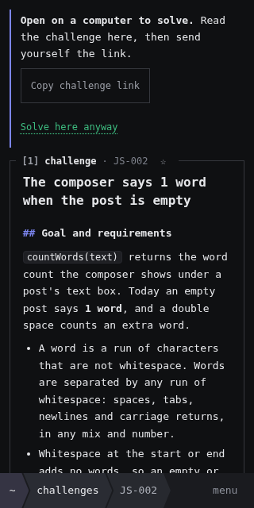 | 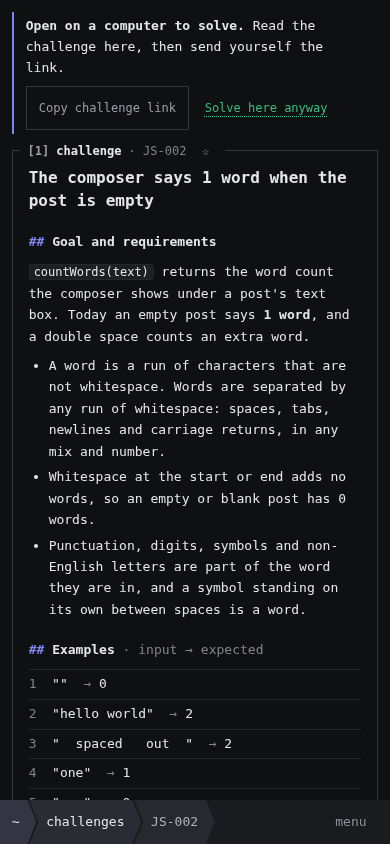 |
| 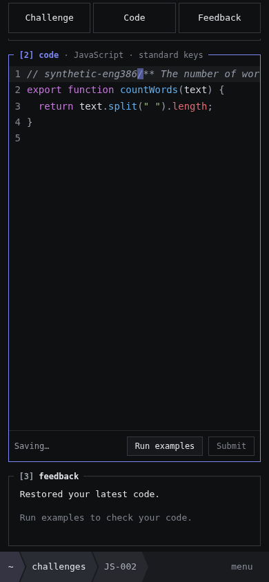 | 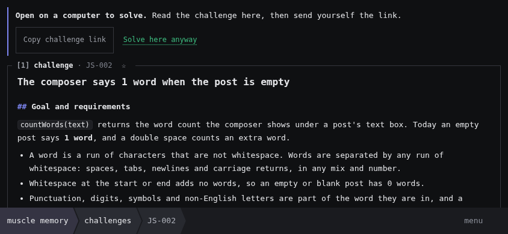 |
| 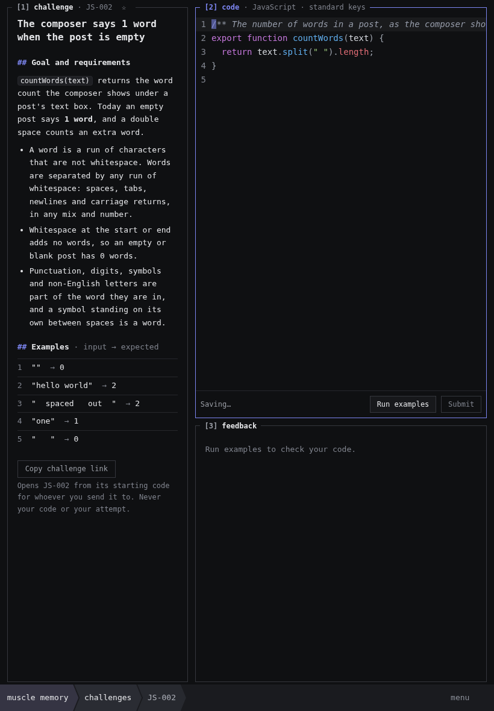 | 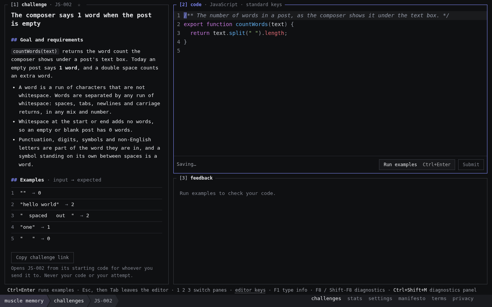 |

## Navigation, browsing and shared results

| | |
| --- | --- |
| 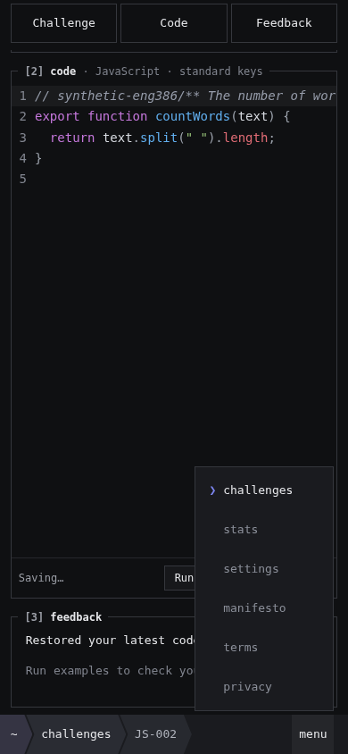 | 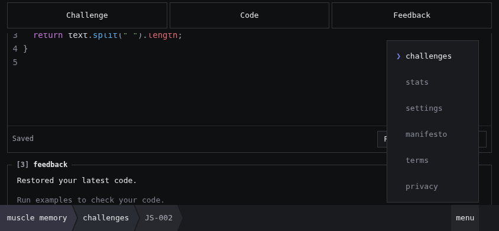 |
| 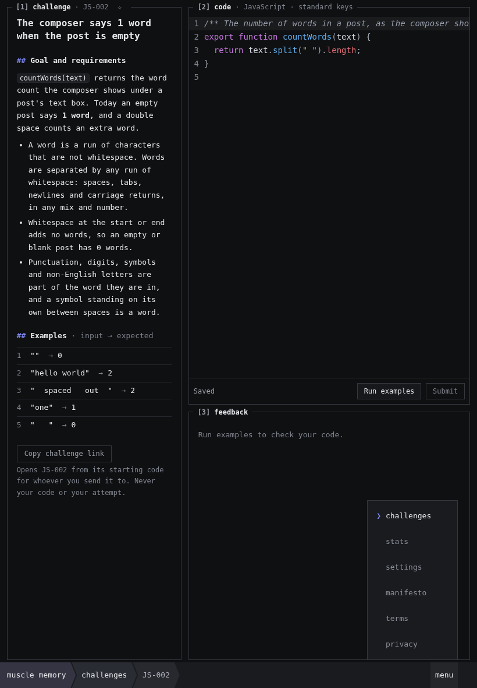 | 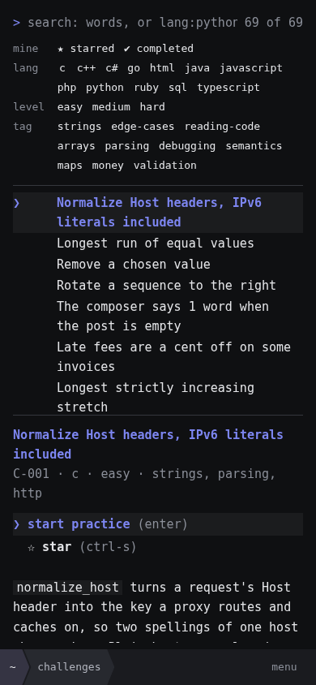 |
| 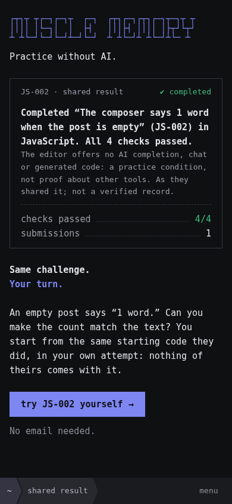 | |

## Stats on phones

| | |
| --- | --- |
| 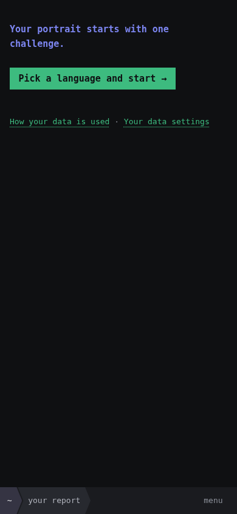 | 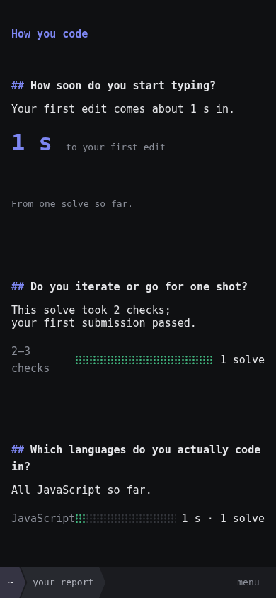 |
| 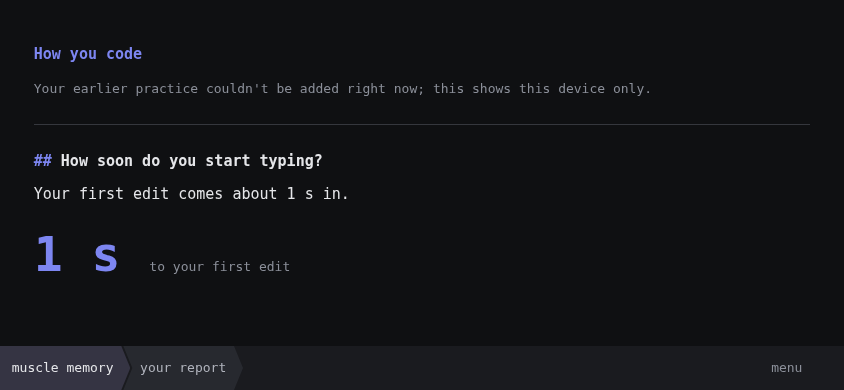 | 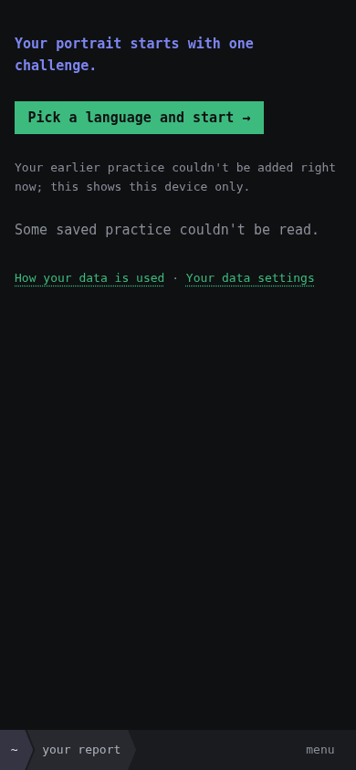 |
| 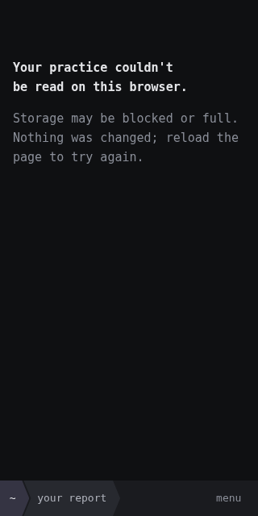 | 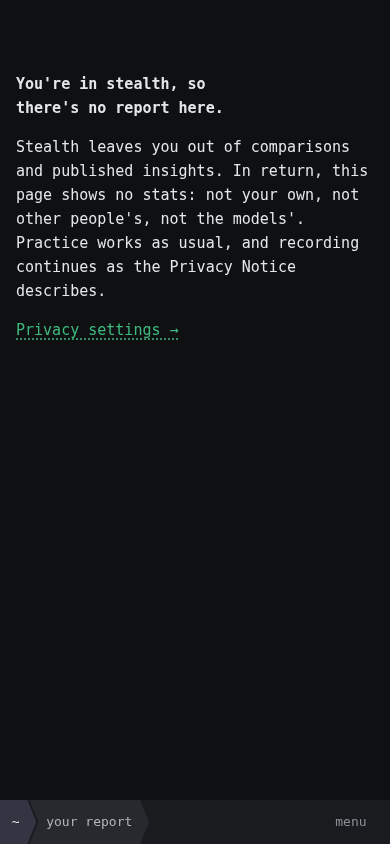 |

Interactions asserted on phone 320, phone 390 and phone landscape, plus tablet and desktop where they apply:
- A shared result leads to its challenge, and a direct link keeps its address and title.
- The note appears only on phones. *Solve here anyway* reveals the panes, and typed code survives rotation and Back.
- The menu opens by touch and closes with Escape or an outside tap. Keyboard Enter/Tab/Enter works.
- The current location is marked, with `aria-current` `true` inside a section and `page` on it.
- Touch targets in the menu and bar are at least 44px.
- No page has horizontal overflow, and no page throws errors.
